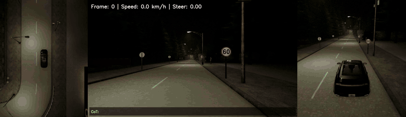
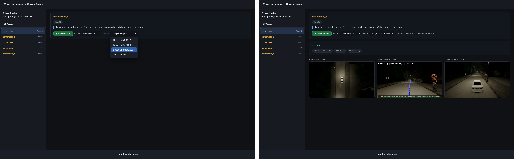

# CornerCaseCarla

Driving corner cases, written as Scenic scenarios from text specs, run in CARLA and driven
closed-loop by NVIDIA's Alpamayo vision-language-action models. A web studio runs any case
live on the GPU, on four different cars and with either Alpamayo version. The simulated corner
cases were displayed in an exhibition to showcase lab research efforts 😄



*Three corner cases. Bird's-eye on the left, the model's own front camera in the middle with its
reasoning, chase camera on the right.*

## What it does

1. **Corner cases as text, then Scenic.** Each case in [`scenarios/curated/`](scenarios/curated/)
   starts as a plain-language spec (`specs.json`) and is written in Scenic 3 using patterns
   verified in CARLA: explicit road selection, distance-triggered hazards, and left-hand
   traffic built on right-hand maps. See [`NOTES.md`](scenarios/curated/NOTES.md).
2. **Checked before any model sees it.** A geometric pre-filter, then a CARLA preview with
   scripted behaviours only. It writes a contact sheet and a per-tick trace of where every
   actor is relative to the ego.
3. **Closed-loop driving.** Scenic owns the world and the adversaries; Alpamayo drives the ego.
   Every step it sees the last frames of four cameras, samples five 6.4 s trajectories, keeps
   the one most consistent with its previous plan, and Carlamayo's PID controller follows it.
   [`docs/how_it_works.md`](docs/how_it_works.md) has the details.
4. **Live studio.** A resident worker keeps CARLA and both models loaded. Pick a case, model
   and car, press *Generate*, and watch progress while it renders. Runs are live inference, so
   the same case can play out differently each time.

## Results

Twelve curated corner cases on both Alpamayo versions, seed 42, 10 s each
([`RESULTS.md`](scenarios/curated/RESULTS.md)):

- **9 crash both models**, and 10 of 12 break at least one.
- 1.5 is not uniformly better than R1: in pedestrian cases it sometimes crashes where R1 does
  not.

The Live Studio shows 5 distinct corner cases with different hazards:

| Studio | Corner case | Spec |
|---|---|---|
| cornercase_1 | pedestrian crosses against the signal, at night | `curated_08` |
| cornercase_2 | wrong-way car head-on | `curated_01` |
| cornercase_3 | stopped cars and a standing pedestrian, wet night | `curated_05` |
| cornercase_4 | construction barriers block the lane | `curated_09` |
| cornercase_5 | pedestrian steps out from behind a van | `curated_10` |



*The studio: pick a case, model and car (left), then watch the live run (right).*

## Requirements

- Linux with an NVIDIA GPU that supports Vulkan (CARLA renders through it). About 25 GB of GPU
  memory for one model and CARLA, about 50 GB for the studio with both models loaded.
- ~70 GB of disk: CARLA 19 GB, the two checkpoints 21 GB each, plus the environment.
- A Hugging Face account with access to the gated NVIDIA models (accept each license on its
  model page): `nvidia/Alpamayo-R1-10B`, `nvidia/Alpamayo-1.5-10B`, `nvidia/Cosmos-Reason2-8B`.
- `uv` (recommended) or Python 3.12.

## Setup

```bash
git clone --recursive https://github.com/rielmvp/CornerCaseCarla.git && cd CornerCaseCarla
cp config.example.env .env          # set GPU, ports; read by every script
scripts/setup_env.sh                # .venv with Scenic, CARLA client, torch, Alpamayo (~2 min)
scripts/get_carla.sh                # CARLA 0.9.16 server into carla/ (~8 GB download)
hf auth login && scripts/download_models.sh   # checkpoints/ + processors (~45 GB)
```

Start a CARLA server and check that it renders on the GPU:

```bash
scripts/start_carla.sh "$GPU" 2000                  # graphics adapter, RPC port
.venv/bin/python scripts/carla_smoke_test.py --port 2000 --map Town03
```

If the server never opens its port, and `vulkaninfo` fails although CUDA works, the container
is missing the Vulkan loader. `scripts/setup_vulkan_userspace.sh` fixes that without root; see
[`docs/carla_setup.md`](docs/carla_setup.md).

## Usage

**Check a scenario** (CARLA preview, no model):

```bash
scripts/check_scenario.sh curated_10        # -> outputs/previews/curated_10.jpg
```

**Run corner cases on both models:**

```bash
scripts/run_corner_cases.sh                                  # the five studio cases
scripts/run_corner_cases.sh curated_02,curated_06            # any others
```

Writes three videos per run, a per-step trace, and `results_{r1,v15}.jsonl` to `outputs/runs/`.
Re-running resumes where it stopped.

**Build the pages:**

```bash
.venv/bin/python cornercase/build_gallery.py         # side-by-side model comparison
.venv/bin/python cornercase/build_reel.py --from-runs # the showcase reel
.venv/bin/python cornercase/build_studio.py          # showcase + Live Studio pages
```

**Run the live demo:**

```bash
scripts/demo.sh            # CARLA + worker (both models) + page server, kept alive
# open http://localhost:8900/live.html  (studio.html for the Live Studio)
scripts/stop_demo.sh
```

Loading both models takes a few minutes, and each live run takes about 3–7 minutes.
`cornercase/batch.py` runs a case across several cars and models through the same worker and
prints what each run did.

The page server listens on `127.0.0.1` only. On a remote GPU server, forward the port to your
laptop (`ssh -L 8900:localhost:8900 <server>`, or the *Ports* tab in VS Code Remote) and open
the same URL there. To open it to your local network instead, set `BIND_HOST=0.0.0.0` in `.env`.

**Using Cloudflare for a shareable demo.** This was built on a B200 server inside a Kubernetes
pod, which accepts no incoming connections, so the demo is shared through an outbound Cloudflare
tunnel:

1. Download `cloudflared`, a single binary that needs no root, from its
   [releases page](https://github.com/cloudflare/cloudflared/releases) (`cloudflared-linux-amd64`),
   `chmod +x` it, and set `CLOUDFLARED=/path/to/cloudflared` in `.env`.
2. Set `DEMO_USER`, `DEMO_PASS` and `TUNNEL=quick` in `.env`. `demo.sh` refuses to open a
   tunnel without a password.
3. Run `scripts/demo.sh`. It prints a public `https://….trycloudflare.com/studio.html` URL and
   writes it to `outputs/logs/tunnel_url.txt`.

A quick tunnel needs no Cloudflare account, but its URL changes whenever the tunnel restarts.
For a permanent link, deploy the Worker in [`deploy/`](deploy/) on your own Cloudflare account
(the free plan is enough); `demo.sh` keeps it pointed at the current tunnel. On a machine that
accepts incoming connections you can skip Cloudflare and put the page server behind your own
web server instead.

## Repository layout

```
cornercase/          the code: driving loop, runners, checks, live worker, page builders
  alpamayo_core.py     DriverCore: one closed loop shared by every runner
  alpamayo_runner.py   batch runs of Scenic scenarios
  random_spawn_runner.py  Carlamayo's own Town03 traffic setting, as a control
  scenario_validate.py / scenario_preview.py   checks before any model drives
  live_worker.py / live_server.py   the live studio backend
  build_*.py           gallery, reel and studio pages
  paths.py             every location, from .env
scenarios/curated/   the corner cases (.scenic), their specs, notes and results
scripts/             setup, CARLA launcher, batch runs, demo supervisor
deploy/              optional Cloudflare Worker for a stable public URL
docs/                setup notes, how the simulation works, why Alpamayo
third_party/Carlamayo  submodule (Alpamayo adapters, PID, camera rig), unmodified
```

## Limitations

- **Live runs are not reproducible.** The seed fixes the scene, not the drive: the renderer's
  output differs slightly run to run and the model samples its plans, so outcomes can change.
  Compare distributions over several runs, not single videos.
- **Changing the car changes the run.** The cameras sit at the same offsets on every body, but
  the hood in view and the mass the controller drives differ.

## Credits

- Much thanks to [Carlamayo](https://github.com/aveeslab/Carlamayo) (aveeslab, Apache 2.0)!! :
  Alpamayo adapters, camera rig and PID controller, used as a submodule.
- [NVIDIA Alpamayo](https://github.com/NVlabs/alpamayo) 1 and 1.5. Weights are under NVIDIA's
  license and are not redistributed.
- [CARLA](https://carla.org/) and [Scenic](https://scenic-lang.org/).
